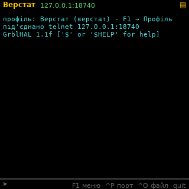
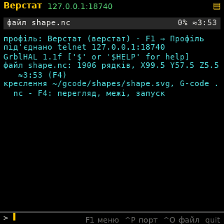

*[Українська версія](SERIAL.md)*

# SERIAL — a pendant and a CAM for grblHAL

SERIAL is a terminal, a pendant and a small CAM program for [grblHAL](https://github.com/grblHAL) machines,
right on the pocket PicoCalc (or the HAT). It talks to the machine over USB or Wi-Fi (telnet), jogs the axes,
runs G-code with progress, and has a shape and text editor that turns a drawing into ready G-code.

| Shape editor | Toolpath view and a run |
|:---:|:---:|
|  |  |

*A circle, a pocketed rectangle and the text "PicoCalc Привіт" → G-code → the view, a run, its progress.
Recorded from the PicoCalc's screen.*

## Contents

1. [Profiles and the connection](#1-profiles-and-the-connection)
2. [The terminal](#2-the-terminal)
3. [The CNC pendant](#3-the-cnc-pendant)
4. [The 3D scanner pendant and the scan wizard](#4-the-3d-scanner-pendant-and-the-scan-wizard)
5. [G-code files](#5-g-code-files)
6. [The toolpath view and runs](#6-the-toolpath-view-and-runs)
7. [The shape editor](#7-the-shape-editor)
8. [Text to engrave](#8-text-to-engrave)
9. [SVG import](#9-svg-import)
10. [$-settings, overrides, inputs](#10--settings-overrides-inputs)
11. [Safety](#11-safety)
12. [Key reference](#12-key-reference)
13. [Where things are](#13-where-things-are)

---

## 1. Profiles and the connection

SERIAL keeps **profiles**, one per machine. Two to start with:

| Profile | Link | Pendant |
|---|---|---|
| **3D-сканер** (3D scanner) | USB (`/dev/ttyACM*`, `/dev/ttyUSB*`) | Y, the rotary table (M102–M104), the ST3215 servo (M101) |
| **Верстат** (CNC) | network: grblHAL telnet, port 23 | X Y Z, the spindle |

**F1 → Профіль** — pick a profile, rename it, change its kind (scanner / CNC), the pendant's axes, add one.
Each profile keeps its own port or address, line end, file folder, spindle speed, editor parameters.

**Over the network** — the easiest is to type in the input line

```
telnet 10.80.39.133
```

and Enter (a port after a space if not 23); also **F3 → Адреса**. A machine that does not answer is retried
every 5 s, and a dropped link comes back by itself. The header shows it: green `10.80.39.133:23` — connected,
orange — connecting, red — no link.

**USB** — the port is picked by itself (the first ACM, then USB) or chosen in **F3**; a board that rebooted is
reconnected. F3 → "Відкрити в minicom" hands the port to the real minicom.

## 2. The terminal

The main screen has two panes:

* **upper** — your commands and the first 1–2 lines of each answer, `ok` / `error` / `ALARM` with the code
  explained;
* **lower** — the full output, everything the device sent. **F2** or **Tab** hides / shows it.

The status line: the state (`Idle`, `Run`, `Hold`, `Alarm`…), coordinates, feed and speed, plugin fields,
overrides, and **in red — the active inputs** (limits, probe, door).

* `?` `!` `~` on an empty line go at once (real-time: status, hold, resume).
* **↑ / ↓** — history, **PgUp / PgDn** — scroll.
* **Ctrl+X** — grbl's soft reset. **Backspace on an empty line in Alarm — `$X`** (unlock).
* **Ctrl+E** — the last error / alarm explained: the code, the firmware's own text (`$EE` / `$EA`, plugin codes
  included), what to do, after which command or file line.
* Leave with `quit` + Enter or **F1 → Вихід** (Esc only clears the line).

> After `error:N` grblHAL refuses the following G-code lines with the same code until an empty line comes.
> SERIAL sends that empty line itself, so after an error you just carry on.

## 3. The CNC pendant

**Ctrl+T** or **F1 → Пульт**. Big work coordinates X Y Z and the machine ones beside, state, feed, spindle.
Polled 5 times a second; a green dot blinks on each answer, a red "немає ?" — none for a second.

| Key | Does |
|---|---|
| ← → | X |
| ↑ ↓ | Y |
| `/` `\` (or PgUp / PgDn) | Z up / down |
| a tap | one step; **held** — continuous, let go — stops at once |
| `+` `-` | step 0.01 / 0.1 / 1 / 10 / 100 mm (a feed to match) |
| `x` `y` `z` | zero an axis in the current WCS (`G10 L20 P0`) |
| `0` | zero all axes |
| `s` | spindle: on — twice within 2 s, off — at once |
| `,` `.` | spindle speed |
| F2 / F3 | feed −10 % / +10 % |
| F4 | feed 100 % |
| F5 | rapids 100 → 50 → 25 % |
| **Backspace** | `$X` — unlock an Alarm |
| **SPACE** or Ctrl+X | **emergency stop** (jog cancel + reset) |
| `e` | explain the error |
| F1 | the keys |
| Esc | back to the terminal |

> The software emergency stop **does not replace** a hardware E-stop button.

HAT: joystick — X / Y, KEY1 / KEY2 — Z, press — step, KEY3 — stop (twice — leave).

## 4. The 3D scanner pendant and the scan wizard

The **3D-сканер** profile: Y, the rotary table's angle (`TBL`, and the absolute `TBLABS`), the ST3215 servo's
angle and its limits (`$451` / `$452`).

| Key | Does |
|---|---|
| ↑ ↓ | Y (step `+` / `-`) |
| ← → | the table by a step (`M104`); `t` / `T` — step 1 5 10 15 30 45 90° |
| `r` / `l` | spin the table CW / CCW (`M102`) |
| `o` | stop the table (`M103`) |
| `/` `\` | the servo by a step (`M101`), `v` / `V` — step 1 / 5 / 15° |
| `y`, `0` | zero Y, zero all |
| Enter | go on after `M0` |
| SPACE | emergency stop (the reset stops the table too) |

**The scan wizard** (`w`): positions per turn, table speed, a settle time after a turn, what to do at each
position (a pause / `M0` — wait for Enter / a pulse on an output `M64`–`M65`), servo angles and Y heights (comma
lists: a full turn for each), unwind after the turn. The count and the time at the bottom. "Створити файл"
writes `~/gcode/scan/scan-….nc` and opens it; "Створити й запустити" runs it at once.

## 5. G-code files

**F4** — the file:

* **Відкрити файл…** — the `~/gcode` folder (`.nc .gcode .ngc .tap .gc .cnc .txt`); its size and estimated time.
* **Запустити весь** — line by line, the next after `ok`; an error pauses with the line number.
* **Покроково** — Enter sends the next line.
* **Пауза / продовжити** (`!` / `~`), **Стоп** (reset).
* **Перегляд траєкторії** — the next section.
* **Межі й перевірка** — each axis's range, the move lengths, the time, and **whether the file fits the travel**
  (`$130`–`$132` with the zero offset; needs homing).
* **Обвести межі** — G0 round the X/Y box at the current Z and back (Idle only, confirmed): is the stock there.
* **Корекції подачі…**

The progress bar: per cent by the estimated time, elapsed and left (scaled by the real speed); a sound at the end
and on errors.

## 6. The toolpath view and runs

**F4 → Перегляд траєкторії**. The path to scale (XY, `v` — XZ): rapids grey, cuts coloured by depth (orange —
deepest, cyan — high), the done part green, a circle — where the tool is now.

**The cross-hair and the G-code window.** The arrows walk a cross-hair along the path (held — faster); the
nearest move lights white, and its line in the window below. **Tab** moves the focus into the window: ↑ / ↓ —
line by line, ← / → or PgUp / PgDn — by 5; the line's moves light on the path.

Above the lines, for the chosen one: **Z** (the move's depth, "from → to" for a plunge) and **when the run gets
there**: "від старту ≈…" (from the start), during a run "через ≈…" (in about), "зараз" (now), "виконано" (done).

**Running from here:**

* `r` — from the start;
* **Enter in the G-code window — from that line.** SERIAL first sets the machine up as the file had it there:
  modes (`G21 G90`, plane, WCS), the spindle with its speed and 3 s to spin up, coolant, a lift to a safe Z, a
  move to X Y before the line, down to Z, the feed — all listed in the confirmation.

While it runs you stay in the view: progress with times, the window and the cross-hair follow the line (arrows
— look around, `f` — follow again), **Space** — pause / resume, **Ctrl+X** — stop. Esc closes the view, the run
goes on. **F1** — help.

## 7. The shape editor

**F1 → Редактор фігур** (in the CNC profile). The field in millimetres, the zero at the bottom left (red and
green ticks — X and Y), its size from the machine's travel.

### The cross-hair

* arrows — a grid step; held — repeats, three times faster after 1.5 s;
* the grid (0.1 / 0.5 / 1 / 2 / 5 / 10 mm) follows the zoom, `g` / `G` — your own;
* `+` / `-` — zoom round the cross-hair, `0` — the whole field, `h` — the cross-hair to the zero.

### Figures

| Key | Figure | Points (Enter places) |
|---|---|---|
| `c` | circle | centre, a point on it |
| `e` | ellipse | centre, a box corner |
| `r` | rectangle | two corners (corner radius in the numbers) |
| `a` | arc | centre, start, end; `d` — direction |
| `l` | line | two ends |
| `t` / `T` | text in a rectangle / circle | see [section 8](#8-text-to-engrave) |

The figure is drawn live while placing, its size at the bottom. Backspace removes the last point, Esc ends the
tool.

### Editing a figure

Put the cross-hair on a figure's line (it turns yellow), or press **Tab** — the cross-hair jumps to the next
figure.

* **Enter — its points, as when drawing.** Squares are its points: corners, centre, radius point, ends. The
  cross-hair on a point (Tab — the next), Enter — grab, arrows — drag, Enter — drop, Esc — put it back. The
  centre (a line's middle) moves the whole figure.
* **Space (or `n`) — exact numbers.** The first field is the figure's **depth** (0 — the common one). Then X / Y
  from the **bottom left corner** (a circle's / ellipse's bounding box) **or the centre**, sizes, corner radius,
  arc angles, the cut. Live; after a number `s` (done) or Enter (next), Esc — cancel.
* **Del / Backspace** — delete, **`u`** — undo.

### The cut and the depth

Closed figures (circle, ellipse, rectangle, a closed outline) have "Обробка":

| Cut | The tool |
|---|---|
| по лінії (on the line) | its centre on the line |
| зовні (outside) | moved out by its radius — the part to size |
| всередині (inside) | moved in by its radius — the hole to size |
| **карман** (pocket) | clears the inside: rings from the centre out at "Карман: крок, % фрези", the last along the wall |

**Depth** — a figure's own (the first number) or the common one; a yellow "↓2.5" marks an own depth on the
drawing. Cut in passes at the common step down; open figures (line, arc) go back and forth.

**`p` — the machining parameters:** safe Z, the common depth, the step down, XY and Z feeds, **the tool
diameter** (shown top right: "Ø3.175 ↓1"), the pocket stepover, the spindle speed (0 — no `M3`), the field size.

### Files, autosave

* A drawing is **`~/gcode/shapes/NAME.svg`** (a plain SVG: a browser, Inkscape), with **`NAME.nc`** — its G-code.
* Both are **saved by themselves** a second after each change: ● — not yet, ✓ — saved.
* A new drawing is called `shape` (`shape-2`, … if taken).
* **`s` — save as**: a new name (the working `shape` is just renamed).
* **`o` — open**: the drawings and "+ нове креслення".
* **Esc twice** (within 2 s) — leave: the G-code opens in SERIAL (F4 — view, bounds, run). One Esc only cancels
  a tool, a selection or a window.
* The editor opens the drawing of the file open in SERIAL, else the last one.

## 8. Text to engrave

* **`t`** — text in a rectangle (two corners), **`T`** — in a circle (centre and a point).
* The text field opens at once: type, **Tab — EN / UA** (the standard Ukrainian layout), **`|` — a new line**,
  Enter — done.
* The letters fill the frame as much as they can, undistorted; in a circle the turned text fits inside.

In the text's numbers (Space on its frame): depth, text, **font** (DejaVu Sans / Serif / Mono, regular and bold),
**the cut**, **the angle**, the frame (rectangle / circle), its position and size.

| Cut | The tool |
|---|---|
| **заливка** (filled, the default) | rings inwards from each letter's edge: the first half a tool in (the letter keeps its shape), then at the pocket stepover; a 1 mm hop between rings |
| контур (outline) | exactly on the letters' lines — for a V-bit |

> Small text wants a thin tool: a stroke thinner than the tool only gets its outline.

## 9. SVG import

**`i`** in the editor — the `.svg` files in `~/gcode`, `~/Downloads` and home. The figures land with their
**bottom left on the cross-hair**, in real millimetres (from the file's units and viewBox, as Inkscape set them).

* Circles, ellipses, rectangles stay what they are.
* Curves (`path`: M L H V C S Q T A Z), polylines and turned figures become **outlines** — polylines with ~0.3 mm
  chords.
* An outline: Enter — its middle moves it, its top right corner scales it; Space — X / Y, width, height, depth.
* Closed outlines cut **outside / inside / as a pocket**.

So draw the hard part in Inkscape on a computer, copy the SVG to the PicoCalc, and only place and run it here.

## 10. $-settings, overrides, inputs

**F1 → Налаштування $** — grblHAL's settings by group with the firmware's names, units, ranges and descriptions
(`$EG` / `$ES` / `$SED`), plugins' too. Bit fields bit by bit, search by typing. Enter — change (sends `$N=…`,
then reads it back). "Зберегти всі в файл" — `~/gcode/settings/<profile>-date.txt`; "Відновити з файлу" opens
such a file, then F4 → Запустити весь. Over telnet grblHAL may refuse to write settings.

**Overrides** (F1 → Корекції, F2–F5 in the pendant): feed ±10 % / ±1 % / 100 %, rapids 100 / 50 / 25 %, spindle.
The "корекції F… R… S…" line turns yellow when something is not 100 %.

**Inputs**: the active signals (`Pn:`) in red: X Y Z — limits, P — probe, D — door, H / R / S — hold / reset /
start buttons, E — E-stop. Press a limit switch by hand and its letter shows: handy for checking the wiring.

## 11. Safety

* Before a run check **Межі й перевірка** and, when in doubt, **Обвести межі**.
* "Run from a line" lifts the tool to the file's highest Z before moving — make sure no clamp stands higher.
* The software emergency stop (SPACE, Ctrl+X) stops motion and the spindle by grbl's reset, but **does not
  replace a hardware E-stop**.
* After an emergency stop or a limit — `$X` (Backspace) and preferably homing `$H`.

## 12. Key reference

**Terminal**

| | |
|---|---|
| F1 | the menu (profile, editor, file, port, grblHAL, settings, overrides, help, exit) |
| F2 / Tab | show / hide the full output |
| F3 / Ctrl+P | port or network |
| F4 / Ctrl+O | the G-code file |
| F5 / Ctrl+G | grblHAL: polling, reset, `$X`, `$H`, `$$`… |
| Ctrl+T | the pendant |
| Ctrl+E | explain the error |
| Backspace (empty line, Alarm) | `$X` |
| `telnet <IP> [port]` | the profile over the network |
| `quit` | leave |

**Toolpath view**: arrows — cross-hair / lines · Tab — the G-code window · Enter — run from the line · `r` —
from the start · Space — pause · Ctrl+X — stop · `f` — follow · `v` — XY / XZ · `+` `-` `0` — zoom · F1 — help ·
Esc — close.

**Shape editor**: `c e r a l t T` — figures · Enter — a point / edit points · Space — numbers · Tab — the next
figure · Del — delete · `u` — undo · `p` — parameters · `s` — save as · `o` — open · `i` — import SVG · `g` —
grid · `+ - 0 h` — the view · F1 — help · Esc Esc — leave.

## 13. Where things are

| Path | What |
|---|---|
| `~/gcode/` | G-code files (F4 → Відкрити) |
| `~/gcode/shapes/` | the editor's drawings: `NAME.svg` + `NAME.nc` |
| `~/gcode/scan/` | the scan wizard's files |
| `~/gcode/settings/` | saved `$` settings |
| `~/.config/lcdtoy/serial.json` | SERIAL's profiles and settings |
| `~/.config/lcdtoy/serial-history` | the command history |
| `/tmp/serialterm-crash.log` | the traceback if SERIAL crashed |

Code: [`app/serialterm.py`](../app/serialterm.py) (terminal, pendants, view), [`app/shapeedit.py`](../app/shapeedit.py)
(editor), [`app/textcut.py`](../app/textcut.py) (text), [`app/svgimport.py`](../app/svgimport.py) (SVG import),
[`app/gcodeinfo.py`](../app/gcodeinfo.py) (G-code analysis, bounds, time, run from a line).
